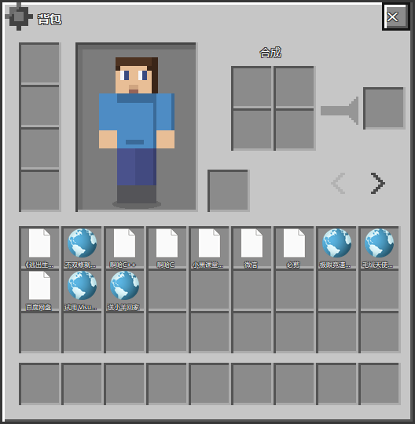
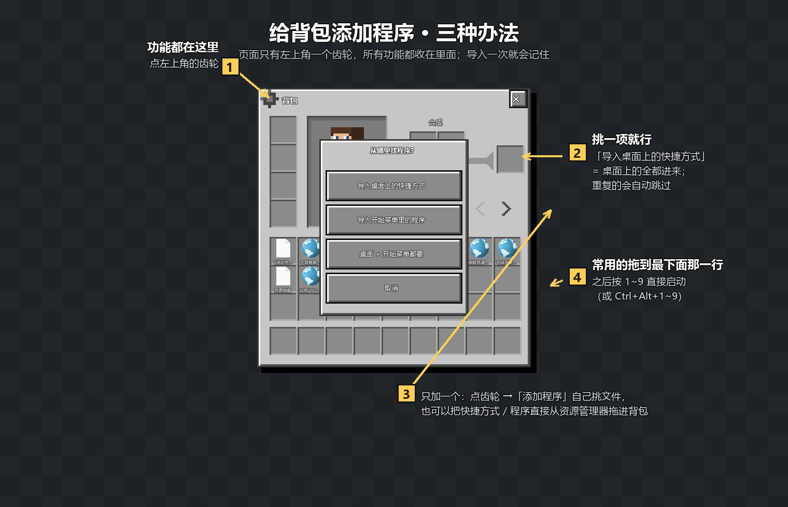
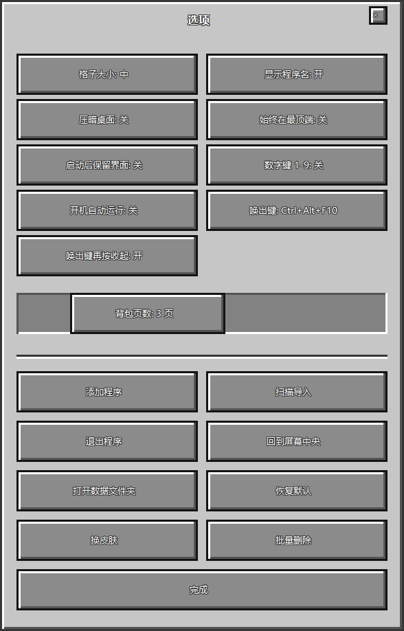

# 我的世界背包

一个长得像《我的世界》物品栏的快捷启动器：把桌面上的快捷方式装进"背包"，常用的拖到最下面那一行"快捷栏"，以后按数字键就能直接打开。

### 怎么把程序装进背包（三种办法）

## 怎么用

1. 双击 `我的世界背包.exe` 打开背包。想随时唤出，按唤出键（默认 `Ctrl + Alt + B`，全局生效）：**按几次都只是把它叫出来、提到最前，不会因为再按一下就收起**。
   想放个桌面图标：双击一次 `创建桌面快捷方式.bat`，或者右键 exe →「发送到」→「桌面快捷方式」。
2. 第一次打开背包是空的：点左上角的**齿轮** →「**扫描导入**」→「导入桌面上的快捷方式」，桌面上的程序就会自动装进背包（开始菜单里的程序也能一起导入）。
3. 单个添加：齿轮 →「**添加程序**」挑文件；或者干脆从资源管理器里把快捷方式/程序**直接拖进背包**。
   **导入一次就够了**：背包和快捷栏的内容会记在 `data\inventory.json` 里，下次打开还在，不用重新导入；重复导入会自动跳过（会提示「跳过重复 N 个」）。
4. 整理：**按住图标拖动**就能换位置，把常用的拖到最下面那一行（快捷栏）。
5. 启动：**双击图标**；快捷栏里的东西按数字键 `1`~`9` 也行。
6. 右键图标：打开 / 打开所在文件夹 / 放进快捷栏 / 从背包移除。
7. 收起背包：按 `Esc` 或 `E`，或者点右上角 ✕。**点背包外面不会把它关掉**——你可以照常点桌面、点浏览器、在别的程序里干活，背包会一直开着待在旁边。

> 主页面刻意做得很干净：只有左上角齿轮、右上角 ✕、左边的角色框和「换皮肤」、中间的背包网格和最下面那行快捷栏。**没有一行小字提示**——所有操作都在齿轮里的「选项」页；想连图标下面的程序名也不显示，就把选项里的「显示程序名」关掉。

## 左边那个角色框

左上角是**角色展示框**，会像游戏里那样站着慢慢左右转身，看的就是你的角色皮肤：

- 程序启动时会去你的 Minecraft 目录里找皮肤：启动器配置里指定的皮肤文件 → `.minecraft\skins` 里你自己放的 → `.minecraft\assets\skins` 里的皮肤缓存；都找不到就用内置的默认形象。
- 想换成自己的皮肤：点「**换皮肤**」，选一张 64×64（或 64×32 老版）的皮肤 PNG。
- 也可以直接把皮肤 PNG **拖到角色框里**，一样能换。
- 换过的皮肤会复制一份到 `data\skin.png`，所以以后移动程序或换电脑也不丢。

## 把背包当小窗口用

## 背包翻页（一页 3×9）

- 背包每页固定 **3 行 × 9 列 = 27 格**，**网格右上角那对小箭头（◀ ▶）点一下翻一页**，多出来的程序就放在后面的页里；
- 默认 **3 页（81 格）**，不够用就在**设置 →「背包页数」滑条**往上调，最多 9 页（243 格）；
- 页数只会自动变大不会变小：如果某一页还装着东西，想往下调会被挡住并提示"至少要 N 页"，所以**不会因为调页数把程序弄丢**；只有一页时箭头不显示。

## 批量删除

设置页里有个「**批量删除**」按钮，点开是两个带后果说明的选项：

- 清空当前页（这 27 格里的程序）
- 清空整个背包（共 N 个程序）

删掉的只是背包里的快捷方式（磁盘上的程序本身不动）。想加回来重新「扫描导入」一次即可。

- **拖着走**：按住背包最上面那一条（写着「背包」的那一行，别按到右边的 ✕）就能把整个窗口拖到任意位置，
  鼠标会变成四向箭头。**左上角的齿轮也可以拿来拖**：按住它移动就是拖窗口，按住它不移动、松手就是打开设置。
  拖到哪就记在哪，下次打开还在那个位置。**设置（选项）窗也一样**：按住它顶部「选项」那一行就能拖着走，位置同样会记住，
  下次打开设置还停在那儿。
- **始终在最顶端**：设置里这个开关（默认开）。关掉之后它就跟普通窗口一样，会被别的窗口盖住；
  配合把「全屏遮罩背景」也关掉，就是一个标准的小窗口，可以和别的程序并排摆着用。
- **周围那圈变暗**：就是「**打开时压暗桌面**」这个效果（仿游戏那种"背包弹出来、周围压暗"的观感）。不想要的话：设置 → 把「打开时压暗桌面」关掉；或者**在窗口顶部那一行右键** → 点「关闭『打开时压暗桌面』」，立刻生效。这层压暗是「点得透」的，不会挡住你点下面的窗口。
- **开着也能干别的**：背包开着时你可以正常操作桌面和其他程序，它不会因为你在外面点一下就收起来。想让它到最前面来，按一次唤出快捷键或者点它一下即可；想收起就用 `Esc` / 点 ✕ / 托盘点退出。
- **窗口顶部右键还有个小菜单**：压暗桌面 / 始终在最顶端 / 启动后保留界面 / 回到屏幕中央 / 打开设置，几个常用的开关不用进设置就能切。
- **拖跑了 / 跑到屏幕外面了**：设置 → 「窗口位置」→「回到屏幕中央」一键回来。

## 快捷键

| 按键 | 作用 |
| --- | --- |
| `Ctrl + Alt + B` | 全局**唤出**背包：没开就打开，已经开着就强行提到最前（哪怕被全屏程序压着）；默认不会再按一次就收起（**想要"再按一次收起"的习惯，把设置里「唤出键再按收起」打开即可**）。默认组合若被别的软件占用，程序会自动换一个能用的 |
| `Ctrl + Alt + 1`~`9` | 直接启动快捷栏第 1~9 个（可在设置里关掉） |
| `1`~`9` | 背包窗口是当前窗口时，按数字直接启动快捷栏对应格子的程序；切到别的程序以后数字键就还给那个程序（不会误触发） |
| `Esc` / `E` | 收起背包 |
| `Delete` | 移除鼠标指着的那一格 |

## 托盘图标

程序会常驻在右下角托盘（宝箱图标）。双击托盘图标也能打开背包，右键菜单里有「打开背包 / 设置 / 退出」。想彻底关掉就走这里。

**只会有这一个实例**：不管双击多少次 exe，都不会再开第二个进程——重复点击只会把已经在跑的那个背包唤出来（所以不用担心点多了占内存）。想换新实例的话，先在托盘右键「退出」，再重新打开。

## 设置里能改什么

设置界面做成了**原版「选项」的样子**：两列按钮，每个按钮上直接写着当前值（点一下就切换），
**背包页数**是一条滑条（点轨道或拖把手都行）；**原本在背包底部那一排按钮也都并进来了**：
「添加程序 / 扫描导入 / 退出程序 / 回到屏幕中央 / 打开数据文件夹 / 恢复默认 / 完成」。
入口就一个：**背包左上角的齿轮**（⚙）。

- **格子大小**：小 / 中 / 大（按屏幕大小挑一个顺眼的）
- **背包页数**：每页固定 3 行 × 9 列 = 27 格；1 ~ 9 页（最多 243 格）。批量导入装不下时会**自动加页**
- **格子显示名称**：图标下面显不显示程序名（关掉就是纯粹的 Minecraft 观感）
- **打开时压暗桌面**：打开背包时把周围压暗（就是"周围变暗一圈"那效果），不想要就关掉
- **始终在最顶端**：关掉后背包会被别的窗口盖住（想当普通小窗口用就关）
- **启动后保留界面**：默认 **关**（启动程序后背包自动让位；原来的「启动后收起」就是这个开关的反面说法）。打开它就能**开着背包连着启动好几个程序**，界面原地不动——双击图标、按数字键、`Ctrl+Alt+数字` 三种启动方式都听这个开关
- **窗口位置 → 回到屏幕中央**：窗口拖跑了或拖到屏幕外面时用
- **数字键 1-9 全局启动**：在任何界面按 `Ctrl + Alt + 数字` 直接启动
- **开机自动运行**：登录 Windows 后自动在后台待命（只留快捷键唤出）
- **打开数据文件夹**

## 数据存在哪

程序目录下的 `data` 文件夹：

- `inventory.json`：背包、快捷栏的内容和设置
- `inventory.json.bak`：上一次的自动备份（万一文件读坏了会自动顶上）
- `icons`：自动缓存的程序图标
- `skin.png`：换过皮肤后留下的副本（没换过就没有这个文件）
- `log.txt`：万一出问题时留下的记录，平时是空的

整个 `data` 文件夹删掉，就等于恢复出厂设置。程序可以整体拷到别的文件夹或 U 盘，数据跟着走。

## 文件夹里都有什么

| 文件 | 说明 |
| --- | --- |
| `我的世界背包.exe` | 主程序，双击就能用 |
| `创建桌面快捷方式.bat` | 双击一次，在桌面上建一个快捷方式 |
| `使用说明.md` | 就是这份说明 |
| `截图示例.png` | 界面示例图 |
| `源码` | C# 源码（想改就改） |
| `重新编译.bat` | 改完源码后双击它，重新生成 exe |
| `data` | 运行时自动生成：背包内容、图标缓存、日志 |

## 常见问题

**按快捷键唤不出来？**
说明这个组合被别的软件占用了（程序启动时会自动换一个能用的，换过的会提示你）。也可以直接双击 `我的世界背包.exe`，它会把已经开着的那个背包唤出来，而不会开第二个进程。

**图标是张空白纸 / 角上有个红色「!」？**
说明这个快捷方式指向的文件现在读不到——比如 OneDrive 里的东西还没下载到本地，或者程序已经卸载了。鼠标悬停会告诉你具体原因。能启动就说明文件本身在，只是图标暂时取不到。

**为什么背包里的图标和桌面上的不太一样？**
程序取的是每个快捷方式**真实指向的那个程序**的图标，所以比 Windows 通用图标更准确。

**有些格子是空白纸图标？**
那是取图标时这个程序还没就绪（典型情况：OneDrive 里的文件还没下载到本地）。等它下载好之后，重新跑一次
`我的世界背包.exe --refresh-icons` 就会把图标全部重新取一遍。

**角色框里不是我自己的皮肤？**
点「换皮肤」选一张自己的 64×64 皮肤 PNG 就行（也可以直接把 PNG 拖进角色框）。如果不想每次手动换，可以把皮肤文件命名为 `skin.png` 放进程序的 `data` 文件夹里，程序会一直用它。

**想开机就用？**
设置里打开「开机自动运行」，会在注册表的 `HKCU\Software\Microsoft\Windows\CurrentVersion\Run` 里加一条。注意：**之后如果把 exe 挪到别的文件夹，这条记录会失效**，重新打开一次这个开关即可。

## 技术说明

- 单个 exe，绿色免安装，不需要装 Python、Node 之类的东西（用的是 Windows 自带的 .NET Framework 4.8，Win10/11 都有）。
- 界面里的贴图（面板、格子、按钮）都是代码画出来的像素图，没有使用《我的世界》的任何原版素材。
- 图标通过系统 shell 的图标列表取得（256px 高清图标，缩到格子里显示）。
- 源码在 `源码` 文件夹里，改完双击 `重新编译.bat` 就能重新生成 exe。
